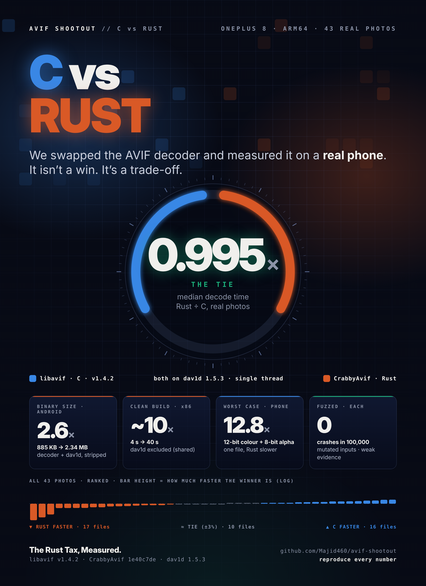
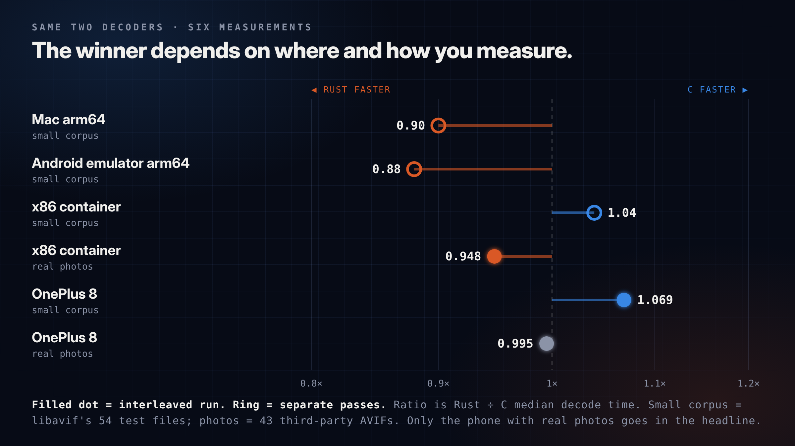
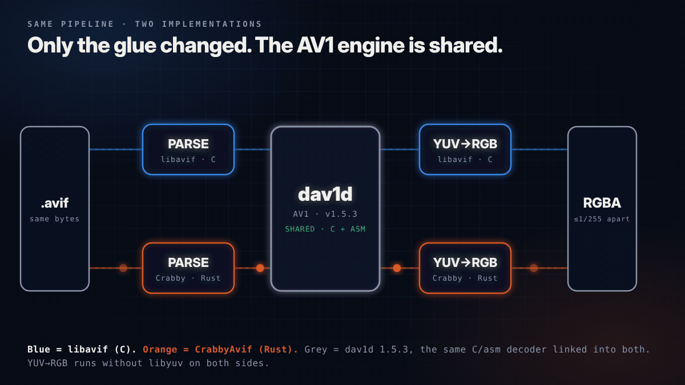
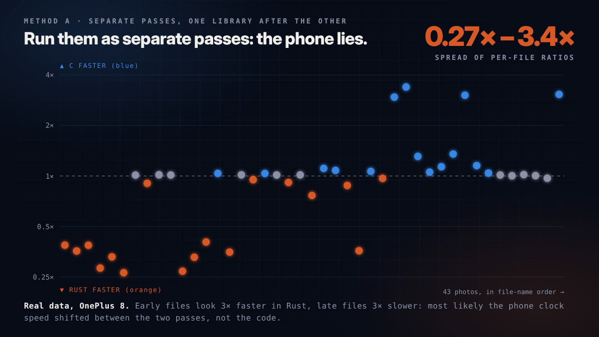

<div align="center">



# avif-shootout

**libavif (C) vs CrabbyAvif (Rust) on a real phone, with the same dav1d engine underneath.**

[Read the article](article/article.md) · [Full results](RESULTS.md) · [Fairness rules](FAIRNESS.md)

</div>

---

## The result in five lines

| | libavif (C) | CrabbyAvif (Rust) |
|---|---|---|
| **Speed, 43 real photos, OnePlus 8** | baseline | **0.995×** median, a tie (faster on 17 files, slower on 16, 10 within 3%) |
| **Binary size, Android arm64** | 885 KB | 2.34 MB (**2.6×**) |
| **Clean build, x86 container (dav1d excluded)** | ~4 s | ~40 s (**~10×**) |
| **Pixels vs the other decoder** | | 12 of 43 photos differ by at most **1/255**; one test file not supported |
| **Fuzzing, 100,000 mutants each** | 0 crashes | 0 crashes (weak evidence, see below) |

Where C clearly wins (small test files, phone): a 12-bit-colour + 8-bit-alpha file is **12.8×** slower in Rust, a 1×5 grid file **6.1×** slower (ARM only), and `extended_pixi.avif` is "Not implemented".

<p align="center"></p>

## Why this repo exists

Chromium made CrabbyAvif its default AVIF decoder and removed the libavif path in 2025, and Google reports big memory-safety gains from Rust in Android. This repo measures the other side of the ledger on a real phone: speed, size, build time and correctness, with the AV1 decoder held constant.

<p align="center"></p>

## The trap this repo avoids

Running library A's whole pass and then library B's on a phone gives per-file ratios from **0.27× to 3.4×**, because CPU clocks drift. `bench/bench_both.cc` puts both decoders in one process and alternates them on every file.

<p align="center"></p>

## Reproduce it

Pinned versions: **dav1d 1.5.3**, **libavif v1.4.2**, **CrabbyAvif `1e40c7de`**. No libyuv, single-threaded, one shared dav1d.

```bash
# Needs: git, cmake, ninja, meson, Rust (rustup), and for Android: NDK, `rustup target add aarch64-linux-android`
./scripts/00_fetch.sh                 # clones pinned sources + the 43-photo corpus
./scripts/10_host.sh                  # host build + small-corpus run
./scripts/12_both_host.sh             # interleaved run on your computer

# Android (arm64 phone or emulator on adb)
ANDROID_SERIAL=<serial> ANDROID_NDK_HOME=<ndk> ./scripts/20_android.sh
ANDROID_SERIAL=<serial> ANDROID_NDK_HOME=<ndk> ./scripts/26_both_android.sh
```

Raw CSVs from my runs are in [`results/raw`](results/raw). Summaries are in [`RESULTS.md`](RESULTS.md).

## Layout

```
bench/      decode_api.h, backend_libavif.cc, backend_crabby.cc, bench_both.cc (interleaved), fuzz_driver.cc, decode_bench.cc
scripts/    fetch / host / Android build + run scripts, summarizers
results/    raw CSVs and fuzz tallies
article/    the write-up and its graphics
docs/       images used in this README
```

## Honest limits

- **One phone** (OnePlus 8, IN2015, arm64). Re-run on yours.
- Per-file extremes (e.g. 0.50× and 1.18×) are not yet confirmed by a second run.
- The size breakdown is a rough x86 symbol estimate; the 885 KB / 2.34 MB figures are measured on Android.
- **Fuzzing is a smoke test:** a simple mutator on 47 small seeds, the Rust side wasn't memory-checked, and both share one dav1d. It does not prove memory safety.
- Not measured: energy, multi-threading, CrabbyAvif's MediaCodec backend, memory footprint.

## License

Apache-2.0 for the code in this repo (see `LICENSE` if present). The third-party AVIF test files keep their own licences; they are fetched, not stored here.
