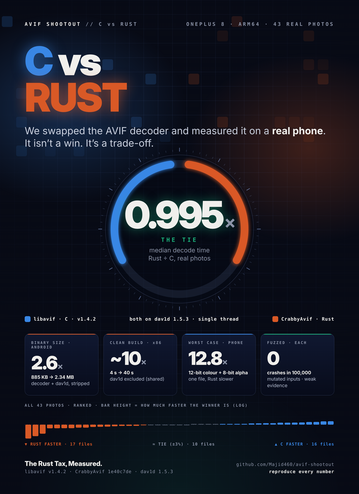
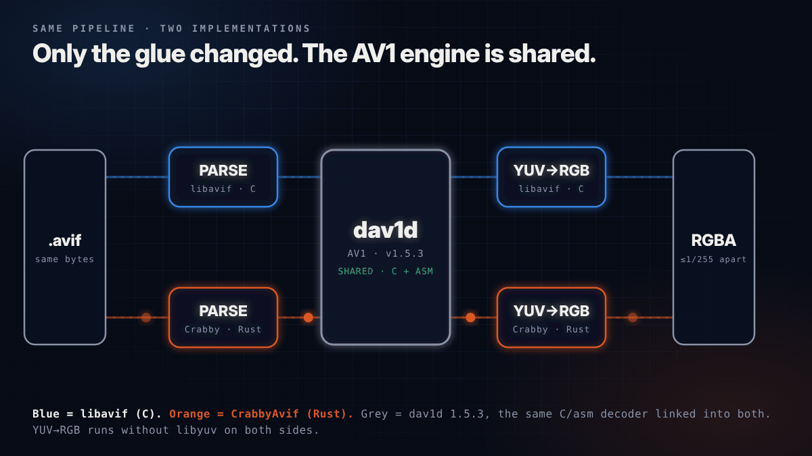
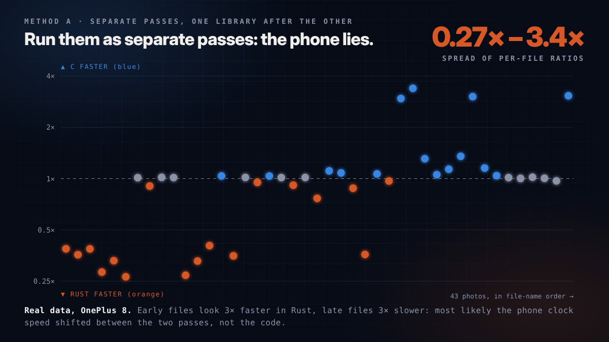
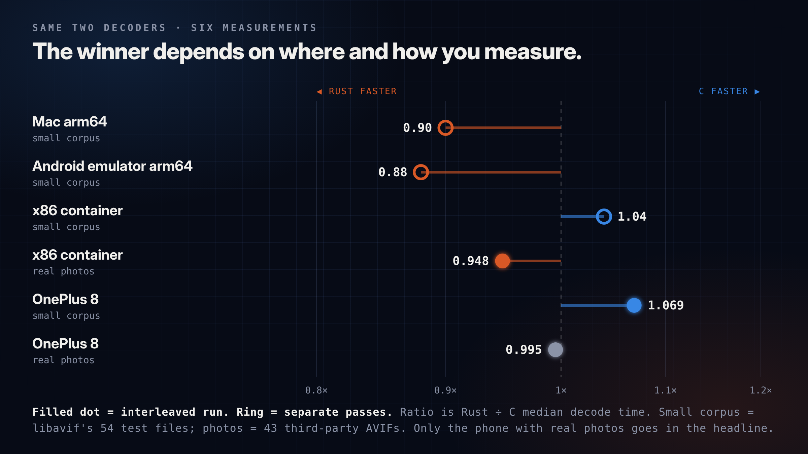
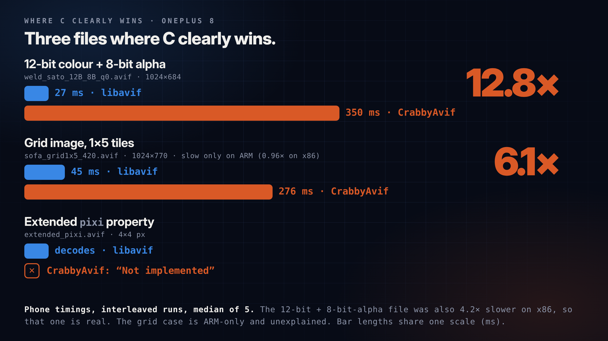
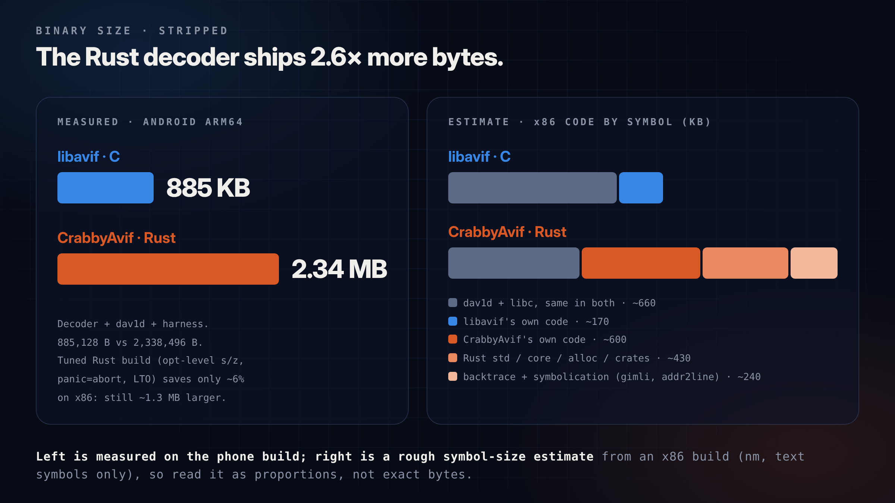
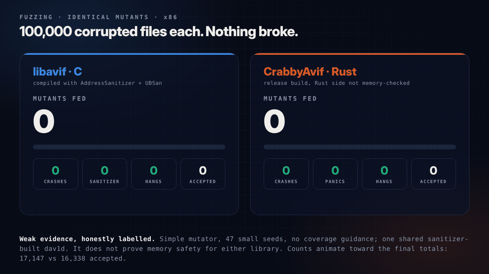

# C vs Rust on a Real Phone: I Raced Two AVIF Decoders

### Same AV1 engine. 43 real photos. A OnePlus 8. And a measurement mistake that nearly fooled me.


*The whole story on one page. Every number is measured, and the repo reproduces all of them.*

---

In January 2025 a Chromium commit with a very plain title landed: **"Remove libavif based AVIF decoder."** The message says CrabbyAvif, a Rust AVIF decoder, "has now been the default for a while now for decoding AVIF images." ([commit](https://chromium.googlesource.com/chromium/src/+/ce78002f97a433e53ab16805e16b895f9b52ea24))

Ten months later Google reported that memory-safety bugs had fallen below 20% of Android's vulnerabilities for the first time, with Rust changes showing a roughly 4× lower rollback rate and about 25% less time in code review. ([Google, Nov 2025](https://blog.google/security/rust-in-android-move-fast-fix-things/))

So the safety story is loud. What I wanted to know was the quiet part: **what does the swap cost you on an actual Android phone?** Speed? Binary size? Build time? Does it even decode the same pixels?

I built a test rig and ran it on a OnePlus 8. The headline is boring in the best way, and the road there contains a trap I want you to avoid.

## The setup: change one layer, freeze the rest

AVIF decoding is a pipeline. The heavy lifting, the actual AV1 decode, is done by **dav1d**, a C library with hand-written assembly. Both libraries I tested use it. What differs is the layer around it: container parsing, glue, and the YUV→RGB conversion.


*Blue is libavif (C). Orange is CrabbyAvif (Rust). Grey is dav1d 1.5.3, the same code linked into both.*

The fairness rules, written down before I ran anything:

- **Same dav1d 1.5.3**, built once and linked into both.
- **No libyuv or sharpyuv** on either side, so each library does its own YUV→RGB.
- **One harness**, single-threaded, hashing the RGBA output so speed only counts where pixels match.
- **Real photos**: 43 third-party AVIFs (Netflix, Microsoft, Link-U, Apple), 0.5 to 18 megapixels, 8, 10 and 12-bit, 4:2:0, 4:2:2 and 4:4:4. Not my own encodes, so I can't have favoured either decoder.
- **Report where C wins.**

The contenders: **libavif v1.4.2** (C) and **CrabbyAvif** at commit `1e40c7de` (Rust, with a libavif-compatible C API).

## Round one: Rust wins. Round two: C wins. Neither was true.

My first runs used libavif's own test files, tiny images that decode in milliseconds. On my Mac (Apple Silicon) CrabbyAvif was about 10% faster. On the Android emulator, 12% faster. On my x86 Linux box it was slightly slower.

Then the real phone. **libavif was 7% faster.**

Same code, same inputs, opposite answers. I could have written the article right there: "Rust is faster on your Mac and slower on your phone!" It would have been a great headline and it would have been wrong.

## The mirage

When I moved to the real-photo corpus, the numbers got strange. Run on the phone, the per-file ratio spread from **0.27× to 3.4×**: early files looked three times faster in Rust, late files three times slower.


*Real data from the OnePlus 8. Same 43 files in both states. Only the measurement method changes.*

The cause was my method. I ran the whole libavif pass, then the whole CrabbyAvif pass. A phone isn't a lab instrument: its CPU clock speed shifts with temperature and scheduling, so one library got a fast phone and the other a slow one. The giveaway was that the "winner" depended on the file's position in the alphabet, not its content.

The fix: put **both decoders in one program and alternate them on every file**, swapping who goes first each round. Drift now hits both equally. The spread collapsed to **0.50×–1.18×**, centred on 1.0.

> Lesson: on a phone, never benchmark A then B. Interleave.

## The real result: a tie

On 43 real photos, interleaved, on the OnePlus 8, the median ratio (Rust time ÷ C time) is **0.995**. Total time ratio **0.984**. CrabbyAvif is faster on 17 files, libavif on 16, and 10 are within 3%.


*Filled dot = interleaved run. Ring = separate passes. The sign of the answer depends on the platform and the method.*

That is the part I want you to take away. **Rust did not make decoding faster, and it did not make it slower.** If someone tells you a rewrite is a performance win, ask on what device, with which corpus, measured how.

## Where C clearly wins

The tie hides some sharp edges, all from libavif's small test set:



- **12-bit colour with 8-bit alpha:** 350 ms in CrabbyAvif vs 27 ms in libavif, **12.8× slower** on the phone, and 4.2× slower on x86 too. This one is real. My guess is a slow conversion path for mixed depths, but I haven't profiled it.
- **A 1×5 grid image:** 6.1× slower on the phone but not on x86 (0.96×). ARM-specific, and I don't know why yet.
- **`extended_pixi.avif`:** CrabbyAvif returns "Not implemented". libavif decodes it.

## The bill you pay in bytes and build time



On Android arm64, the stripped benchmark binary (decoder + dav1d + harness) is **885 KB with libavif and 2.34 MB with CrabbyAvif: 2.6× bigger.** A symbol-level look at an x86 build shows where the extra goes: the decoder's own code, the Rust standard library, and about 240 KB of backtrace and symbolication machinery. Turning on size optimisation, `panic=abort` and LTO shaved only about 6%; the Rust side stayed roughly 1.3 MB larger.

Clean builds on my 2-core x86 box, dav1d excluded because it's shared: **about 4 s for libavif, about 40 s for CrabbyAvif**, roughly 10×.

## Same pixels? Almost.

Of the 43 photos, 31 came out bit-identical. The other 12 differ, but the largest difference anywhere is **1 out of 255 on a single channel, on a vanishing fraction of bytes**. That's rounding in the YUV→RGB step, not a decoding bug. On x86 all 43 matched exactly.

## Fuzzing: nothing broke, and that proves little



I fed each library 100,000 identical corrupted inputs. libavif (built with AddressSanitizer and UBSan) had no crashes, sanitizer reports or hangs. CrabbyAvif had no crashes, panics or hangs. libavif accepted 17,147 mutants and CrabbyAvif 16,338, so Crabby was somewhat stricter.

Please don't read that as "both are safe." It's a simple mutator on 47 small seed files with no coverage guidance, the Rust side wasn't memory-checked, and both share one dav1d. It's a smoke test, not a verdict. The honest takeaway is that neither library fell over.

## So should you switch?

Here is how I read the evidence:

- **Speed is not a reason, and not a reason against.** On real photos on a real phone it's a tie.
- **Safety is the real argument.** Google's numbers are about whole-platform code, not this decoder, and I didn't measure memory safety. But a parser that handles untrusted image files is exactly where that argument bites.
- **The price is concrete:** a binary about 2.6× larger, a build about 10× slower, a couple of unsupported or slow edge cases, and pixels that can differ by 1/255.
- **If you ship an APK with a bundled decoder,** check your own size budget first. If you decode untrusted images from the network, the safety trade may be worth it.

What I did not measure: battery or energy use, multi-threaded decoding, CrabbyAvif's MediaCodec (hardware) backend, memory footprint, or other phones. One device, one SoC, one run set. Treat the 0.995 as "about a tie on this device," and re-run the repo on yours.

## Reproduce it

Everything is in the repo: pinned versions, the build scripts, the interleaved harness, the fuzzer and every raw CSV.

- **Repo:** https://github.com/Majid460/avif-shootout
- **Interleaved benchmark harness (gist):** https://gist.github.com/Majid460/db3db4d3df8f95e75aee7f8d8d5e1aee
- **Fuzz driver (gist):** https://gist.github.com/Majid460/ce86a9fb7c0b230b088552825021a0c0
- **Android cross-build and run scripts (gist):** https://gist.github.com/Majid460/89bd64da62d377781a4f2dd48ca722a1

```
./scripts/00_fetch.sh
ANDROID_SERIAL=<your phone> ANDROID_NDK_HOME=<ndk> ./scripts/20_android.sh
ANDROID_SERIAL=<your phone> ANDROID_NDK_HOME=<ndk> ./scripts/26_both_android.sh
```

If you get a different answer on your phone, I want to see it. That is the whole point.

---

*Measured on: OnePlus 8 (IN2015, arm64); Apple Silicon Mac; Android arm64 emulator; x86_64 Linux container. Versions: dav1d 1.5.3, libavif v1.4.2, CrabbyAvif 1e40c7de. Facts about Chromium and Google's Rust-in-Android statistics come from the linked sources.*
